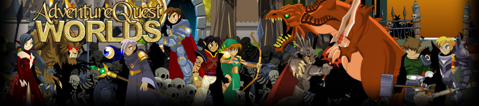

# AQWorlds Classic

An unofficial iOS and iPadOS client for AQWorlds Classic.

## Downloads

| Channel | Version | IPA |
| --- | --- | --- |
| Stable | 1 | [Download Classic IPA (no bot)](https://github.com/krittayot611/aqworlds-classic-ios/releases/download/v1/AQWorlds-Classic-1.ipa) |
| Unstable | 1.1.8 | [Download IPA with Skills, Mobs and Bookmark](https://github.com/krittayot611/aqworlds-classic-ios/releases/download/v1.1.8-unstable/AQWorlds-Classic-1.1.8-unstable.ipa) |

Classic 1 uses manual touch controls. iOS displays it as **1.0.0**. Unstable 1.1.8 reserves a toolbar beside the game on iPhone and iPad.

- **Skills** contains the start and stop button. Select a class and a saved set, or tap **Edit** to change the casting order and conditions.
- **Mobs** lists individual spawns across the current map. Tap a monster to request its cell directly, even when there are no players or exits to follow. On arrival the app selects the exact spawn you tapped.
- **Bookmark** saves the map instance, cell and entry pad on this device. Tap a saved location to warp to that room and pad. Swipe left and tap **Delete** to remove it. For a new cell or a different map instance, the app requests direct entry at the destination. The status shows where you arrived or whether the warp could be confirmed.

Version history and earlier downloads

| Version | Previous number | Edition or feature |
| --- | --- | --- |
| [1](https://github.com/krittayot611/aqworlds-classic-ios/releases/tag/v1) | 0.1.9 | Classic touch controls (no bot) |
| [1.1.1](https://github.com/krittayot611/aqworlds-classic-ios/releases/tag/v1.1.1-unstable) | 0.1.10 | Map reader |
| [1.1.2](https://github.com/krittayot611/aqworlds-classic-ios/releases/tag/v1.1.2-unstable) | 0.1.11 | Bot controls and skill rotation |
| [1.1.3](https://github.com/krittayot611/aqworlds-classic-ios/releases/tag/v1.1.3-unstable) | 0.1.12 | Saved skill sets by class |
| [1.1.4](https://github.com/krittayot611/aqworlds-classic-ios/releases/tag/v1.1.4-unstable) | 0.1.13 | Health, mana and named aura conditions |
| [1.1.5](https://github.com/krittayot611/aqworlds-classic-ios/releases/tag/v1.1.5-unstable) | 0.1.14 | Cooldown switches and swipe to delete |
| [1.1.6](https://github.com/krittayot611/aqworlds-classic-ios/releases/tag/v1.1.6-unstable) | — | Named skills, map monsters and bookmarks |
| [1.1.7](https://github.com/krittayot611/aqworlds-classic-ios/releases/tag/v1.1.7-unstable) | — | Separate right-edge features, map-wide monster selection and a simpler skill overview |
| [1.1.8](https://github.com/krittayot611/aqworlds-classic-ios/releases/tag/v1.1.8-unstable) | — | Dedicated side toolbar, start/stop inside Skills and one-tap cell and pad travel |

## About

AQWorlds Classic is an independent client for the original AdventureQuest Worlds on iPhone and iPad.

Artix's [experimental launcher](https://www.artix.com/experiments/ArtixExperimentalLauncher) already provides Android access. This project was created to give iOS and iPadOS players a practical way to play the classic game, with touch controls and a sideloadable app.

The client loads official game content and connects to the existing AQWorlds servers. An internet connection and an existing AQWorlds account are required.

## Login and account privacy

Sign in on the official AQWorlds login screen inside the app. The game sends your login directly to Artix at `game.aq.com` over HTTPS. The iOS launcher does not store or log your AQWorlds username or password, or send either to a server run by this project. [View the login configuration](https://github.com/krittayot611/aqworlds-classic-ios/blob/a1ca22548169227072808189a3fa4f94f2ed5b23/Main.as#L324)

The game has its own options to remember your username and password on this device. Leave both unchecked if you do not want the game to remember your login. HTTPS protects the connection to Artix. A modified IPA or a compromised device can still expose your credentials.

## Development status

The project is in active development. Current work focuses on display layout, touch input, stability and compatibility across iPhone and iPad. Use Grimlite Rev or Skua as the reference for every new feature. Check how the corresponding tool behaves and how players operate it, then adapt those steps for touch on iPhone and iPad. Keep controls inside the safe area, provide touch targets of at least 44 × 44 points, and let lists scroll on smaller screens.

Report problems through [GitHub Issues](https://github.com/krittayot611/aqworlds-classic-ios/issues). Include your device model, OS version, app version and the steps needed to reproduce the issue. Screenshots are helpful for display problems.

## Installation

Install the IPA with [Sideloadly](https://sideloadly.io/) on Windows or macOS.

1. Install Sideloadly and complete the setup requirements for your computer.
2. Download the IPA for your chosen channel.
3. Connect your iPhone or iPad by USB, unlock it and select **Trust** when prompted.
4. Open Sideloadly, select your device and drag the IPA into the window.
5. Enter your Apple ID, select **Start** and complete authentication.
6. If required, trust the signing profile in **Settings → General → VPN & Device Management**. On iOS or iPadOS 16 and later, enable **Settings → Privacy & Security → Developer Mode**, then restart and confirm.

**Updates:** Install the new IPA over the existing app using the same Apple ID, signing team and bundle ID settings. Re-sign the app when its provisioning profile expires.

## Compatibility

| Platform | Requirements | Status |
| --- | --- | --- |
| iPhone | 64-bit device, iOS 12.0 or later (12.2 for Unstable 1.1.8) | iOS build available |
| iPad | 64-bit device, iOS 12.0 or later (12.2 for Unstable 1.1.8), or iPadOS | iOS build available |
| 32-bit iOS devices | — | Not supported |
| Android | — | No build provided by this project |
| Windows, macOS and Linux | — | No desktop game build provided |

Windows and macOS are supported as installation hosts through Sideloadly. Device compatibility testing is ongoing.

## Disclaimer

**Play at your own risk.** This is a third-party client with optional skill automation. Artix prohibits botting and third-party programs and may terminate accounts for violating those rules. [AQWorlds Rules and Guidelines](https://www.aq.com/lore/guides/AQWRules)

AQWorlds and its game content, artwork and trademarks belong to Artix Entertainment. This is an independent, unofficial project, with no affiliation, endorsement or support from Artix Entertainment.

AI tools are used to assist with implementation, debugging and documentation.

The software is provided as is, without warranty. Access to AQWorlds remains subject to Artix Entertainment's terms and policies.
